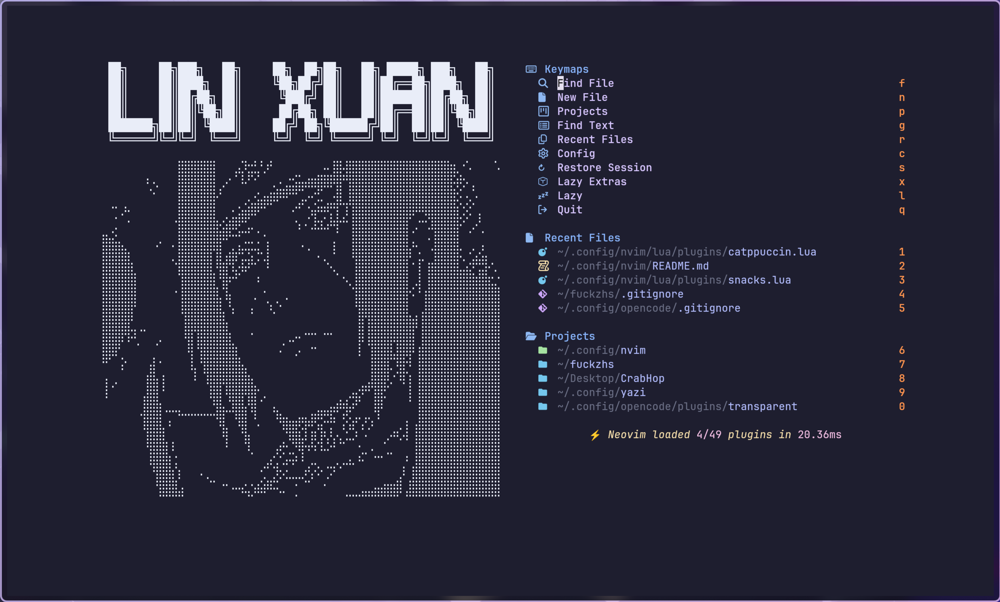

# Neovim Configuration · Neovim 配置说明



---

# English

Base framework: [LazyVim](https://github.com/LazyVim/LazyVim) (v16, Neovim ≥ 0.11)
Plugin manager: [lazy.nvim](https://github.com/folke/lazy.nvim)
Installed plugins: 49

## 1. Features

1. **Few hand-written plugin specs**: most capabilities come from LazyVim's built-in
   presets selected via `:LazyExtras` (see `lazyvim.json`). Only 6 files are customized.
2. **Python uses basedpyright**; inlay hints are disabled by default (toggle with `<leader>uh`).
3. **Annoying defaults turned off**: no automatic comment continuation, no spell check,
   no LSP progress popups.
4. **Auto-save on buffer switch / focus loss** (`autowriteall`).
5. **Two custom tools**: live HTML preview in the browser (`:HtmlPreview`),
   multi-instance terminal on `<leader>t`.
6. **Git signs come from `mini.diff` instead of `gitsigns.nvim`** — LazyVim's
   `editor.mini-diff` extra disables `lewis6991/gitsigns.nvim` and replaces it with
   `nvim-mini/mini.diff` for the sign column, hunk navigation and hunk staging.

## 2. Enabled LazyVim Extras

Config: `lazyvim.json`

| Extra | Purpose |
|---|---|
| `ai.copilot` | GitHub Copilot inline completion |
| `ai.sidekick` | Embed AI CLIs (opencode / claude…) inside Neovim |
| `dap.core` | Debugger framework (nvim-dap) |
| `editor.mini-diff` | Sign-column diff markers (replaces gitsigns) |
| `lang.clangd` | C / C++ support |
| `lang.rust` | Rust support (rustaceanvim) |
| `lang.python` | Python support |
| `lang.json` | JSON + schema completion |
| `lang.markdown` | Markdown support + preview |
| `lang.toml` | TOML support |
| `lang.typst` | Typst + live preview |

## 3. Plugin List

### Core

| Plugin | Description |
|---|---|
| `LazyVim` | The configuration framework itself |
| `lazy.nvim` | Plugin manager, open with `:Lazy` |
| `plenary.nvim` | General Lua utility library (dependency of many plugins) |
| `nui.nvim` | UI component library (used by noice) |
| `nvim-nio` | Async IO library |

### Appearance

| Plugin | Description |
|---|---|
| `catppuccin` | Active colorscheme (mocha) |
| `tokyonight.nvim` | Fallback colorscheme |
| `bufferline.nvim` | Top buffer tabline |
| `lualine.nvim` | Statusline |
| `mini.icons` | Filetype icons |
| `noice.nvim` | Rewrites cmdline / messages / notifications (LSP progress popups disabled) |
| `snacks.nvim` | All-in-one: picker, dashboard, terminal, image preview |
| `trouble.nvim` | Diagnostics / references sidebar |
| `todo-comments.nvim` | Highlight TODO / FIXME / NOTE |
| `render-markdown.nvim` | Render Markdown styling directly in the buffer |
| `ts-comments.nvim` | Treesitter-aware comment strings (fixes comment syntax in embedded languages) |

### Editing

| Plugin | Description |
|---|---|
| `flash.nvim` | Character-based jump (`s`) |
| `mini.ai` | Enhanced `a` / `i` text objects |
| `mini.pairs` | Auto-pair brackets and quotes |
| `grug-far.nvim` | Project-wide search & replace UI |
| `nvim-treesitter` | Parsing: highlighting, indent, folds |
| `nvim-treesitter-textobjects` | Jump/select by function, class, parameter |
| `nvim-ts-autotag` | Auto-close and rename-sync HTML/JSX tags |
| `persistence.nvim` | Session save / restore |

### Completion & AI

| Plugin | Description |
|---|---|
| `blink.cmp` | Completion engine (Rust, replaces nvim-cmp) |
| `friendly-snippets` | Ready-made snippet collection |
| `copilot.lua` | Copilot completion core |
| `blink-copilot` | Feeds Copilot into blink.cmp's menu |
| `sidekick.nvim` | Embed AI CLIs; send selections, accept/reject their edits |
| `lazydev.nvim` | Lua LSP enhancement for editing the Neovim config |

### LSP / Formatting / Linting

| Plugin | Description |
|---|---|
| `nvim-lspconfig` | LSP client configurations |
| `mason.nvim` | Installer for LSPs, formatters, debug adapters |
| `mason-lspconfig.nvim` | Bridges mason-installed LSPs to lspconfig |
| `SchemaStore.nvim` | JSON / YAML schema source |
| `conform.nvim` | Formatter (runs on save) |
| `nvim-lint` | Linters |

### Debugging (DAP)

| Plugin | Description |
|---|---|
| `nvim-dap` | Debugger core |
| `nvim-dap-ui` | Debug UI (variables / breakpoints / stack) |
| `nvim-dap-virtual-text` | Inline variable values |
| `nvim-dap-python` | Python debug adapter |
| `mason-nvim-dap.nvim` | Auto-installs debug adapters |

### Git

| Plugin | Description |
|---|---|
| `mini.diff` | **Sign column + hunk navigation / staging** (`]h` `[h` `gh` `gH`) |
| `gitsigns.nvim` | Disabled by the mini-diff extra; only a stale entry remains in `lazy-lock.json` |

> Full Git operations (stage/unstage/blame/history/push) go through lazygit: `<leader>gg`

### Language-specific

| Plugin | Language |
|---|---|
| `rustaceanvim` | Rust: LSP / debug / test in one |
| `crates.nvim` | Rust: dependency hints and updates in `Cargo.toml` |
| `clangd_extensions.nvim` | C/C++: clangd enhancements |
| `venv-selector.nvim` | Python: virtualenv switching |
| `typst-preview.nvim` | Typst: live browser preview |
| `markdown-preview.nvim` | Markdown: browser preview |

## 4. Local Customization (6 files)

| File | What it does |
|---|---|
| `init.lua` | Entry point; enables `autowriteall`; loads HTML preview |
| `lua/config/lazy.lua` | lazy.nvim bootstrap; disables gzip/tar/zip runtime plugins for faster startup |
| `lua/config/options.lua` | basedpyright for Python; no comment continuation; arrows wrap lines; wrap on; `scrolloff=2` |
| `lua/config/keymaps.lua` | `pp` = Esc in insert/visual; `\` saves in normal/cmd |
| `lua/config/autocmds.lua` | Removes LazyVim's spell autocmd; disables comment continuation globally |
| `lua/config/html_preview.lua` | Custom: `:HtmlPreview` serves the buffer over local HTTP and reloads the browser as you type (works without saving) |
| `lua/plugins/snacks.lua` | Dashboard, picker, terminal, image preview (see below) |

## 5. Plugin Override Files

| File | What was changed |
|---|---|
| `lua/plugins/snacks.lua` | Dashboard (ASCII art header + four panes: keymaps / recent files / projects / git status), **the ASCII portrait is Itachi Uchiha (宇智波鼬)**; picker shows hidden files; terminal; image & PDF preview; `<leader>t` for multiple terminal instances |
| `lua/plugins/lsp.lua` | Inlay hints disabled by default |
| `lua/plugins/noice.lua` | LSP progress notifications disabled |
| `lua/plugins/catppuccin.lua` | Uses catppuccin's own `load()` instead of the built-in theme name |
| `lua/plugins/example.lua` | LazyVim template; first line is `if true then return {} end` — loads nothing, safe to delete |

## 6. Keymap Cheat Sheet

### General

| Key | Action |
|---|---|
| `\` | Save (normal / cmd) |
| `pp` | Esc (insert / visual) |
| `<leader>t` | Terminal (count prefix opens more instances) |
| `:HtmlPreview` | Live HTML preview |

### Files & Search

| Key | Action |
|---|---|
| `<leader><space>` | Find files |
| `<leader>/` | Search text in project |
| `<leader>sg` / `<leader>sw` | Grep / search word under cursor |
| `<leader>sr` | Project search & replace (grug-far) |
| `s` | flash jump |

### Git

| Key | Action |
|---|---|
| `<leader>gg` / `<leader>gG` | lazygit (project root / cwd) |
| `]h` / `[h` | Next / previous hunk |
| `gh` / `gH` | Stage / reset hunk |
| `<leader>go` | Toggle inline diff overlay |
| `<leader>gb` | Blame current line |
| `<leader>gl` / `<leader>gf` | Commit log / current file history |
| `<leader>gs` / `<leader>gd` | Git status / diff |

### AI

| Key | Action |
|---|---|
| `<leader>aa` | Toggle AI CLI sidebar |
| `<C-.>` | Jump between code and AI sidebar |
| `<leader>at` | Send current line / selection to AI |
| `<leader>af` / `<leader>av` | Send whole file / selection text only |
| `<leader>ap` | Preset prompt menu |
| `<leader>as` | Pick which CLI to use |

### Debug & Diagnostics

| Key | Action |
|---|---|
| `<F5>` | Start / continue debugging |
| `<leader>db` | Toggle breakpoint |
| `<leader>du` | Open debug UI |
| `<leader>xx` | Diagnostics list (trouble) |
| `<leader>uh` | Toggle inlay hints |
| `<leader>uf` | Toggle format-on-save |

### UI toggles

| Key | Action |
|---|---|
| `<leader>uG` | Show / hide diff signs |
| `<leader>us` | Spell check |
| `<leader>uw` | Line wrap |
| `<leader>ul` | Line numbers |

## 7. Chinese Localization

This config ships with the default **English** menus.

If you want Chinese descriptions in the which-key menu and elsewhere, use:

**https://github.com/linxuan-sys/ChineseLazynvim**

## 8. Maintenance

```vim
:Lazy            " Plugin manager UI (update / clean / profile)
:LazyExtras      " Toggle LazyVim presets
:Mason           " Install LSPs / formatters / debug adapters
:checkhealth     " Full health check
:TSUpdate        " Update treesitter parsers
```

- `lazy-lock.json` pins every plugin to an exact commit, so the setup is reproducible
- To temporarily disable a plugin, add `enabled = false` to its spec

---

# 中文

基础框架：[LazyVim](https://github.com/LazyVim/LazyVim)（v16 系列，Neovim ≥ 0.11）
插件管理：[lazy.nvim](https://github.com/folke/lazy.nvim)
已装插件：49 个

## 一、这套配置的特点

1. **手写的插件配置较少**：绝大部分能力通过 `:LazyExtras` 勾选 LazyVim 官方预设获得（见 `lazyvim.json`），自己也只改了 7 个文件。
2. **Python 用 basedpyright**，inlay hints（内联类型提示）默认关闭，`<leader>uh` 切换。
3. **关掉了几处「烦人」的默认行为**：注释不自动延续、不做拼写检查、关掉 LSP 进度条弹窗。
4. **失焦 / 切 buffer 自动保存**（`autowriteall`）。
5. **两套自定义工具**：HTML 浏览器实时预览（`:HtmlPreview`）、`<leader>t` 开多实例终端。
6. **默认的 gitsigns 换成了 mini.diff**：LazyVim 的 `editor.mini-diff` 预设会关闭
   `lewis6991/gitsigns.nvim`，改用 `nvim-mini/mini.diff` 接管边栏标记、hunk 跳转与暂存。

## 二、启用的 LazyVim Extras

配置位置：`lazyvim.json`

| Extra | 作用 |
|---|---|
| `ai.copilot` | GitHub Copilot 行内补全 |
| `ai.sidekick` | 在 nvim 内嵌 AI CLI（opencode / claude 等） |
| `dap.core` | 断点调试框架（nvim-dap） |
| `editor.mini-diff` | 边栏改动标记（替代 gitsigns） |
| `lang.clangd` | C / C++ 语言支持 |
| `lang.rust` | Rust 语言支持（rustaceanvim） |
| `lang.python` | Python 语言支持 |
| `lang.json` | JSON + Schema 补全 |
| `lang.markdown` | Markdown 支持 + 预览 |
| `lang.toml` | TOML 支持 |
| `lang.typst` | Typst 排版语言 + 实时预览 |

## 三、插件清单

### 核心

| 插件 | 说明 |
|---|---|
| `LazyVim` | 配置框架本体 |
| `lazy.nvim` | 插件管理器，`:Lazy` 打开界面 |
| `plenary.nvim` | 通用 Lua 工具库（很多插件依赖） |
| `nui.nvim` | UI 组件库（noice 依赖） |
| `nvim-nio` | 异步 IO 库 |

### 外观

| 插件 | 说明 |
|---|---|
| `catppuccin` | **当前配色**（mocha 系） |
| `tokyonight.nvim` | 备用配色（启动兜底） |
| `bufferline.nvim` | 顶部 buffer 标签栏 |
| `lualine.nvim` | 底部状态栏 |
| `mini.icons` | 文件类型图标 |
| `noice.nvim` | 重写命令行 / 消息 / 通知 UI，已关掉 LSP 进度弹窗 |
| `snacks.nvim` | **一站式全家桶**：选择器、首页 Dashboard、终端、图片预览 |
| `trouble.nvim` | 诊断 / 引用列表侧栏 |
| `todo-comments.nvim` | 高亮 TODO / FIXME / NOTE |
| `render-markdown.nvim` | 直接在编辑区渲染 Markdown 样式 |
| `ts-comments.nvim` | 用 treesitter 判断注释符号（避免嵌在 JS 里的 CSS 注释出错） |

### 编辑增强

| 插件 | 说明 |
|---|---|
| `flash.nvim` | 用字符跳转快速移动光标（`s` 键） |
| `mini.ai` | 增强 `a` / `i` 文本对象（如 `ciq` 改引号内容） |
| `mini.pairs` | 括号 / 引号自动配对 |
| `grug-far.nvim` | 项目级搜索替换界面 |
| `nvim-treesitter` | 语法解析，提供高亮 / 缩进 / 折叠 |
| `nvim-treesitter-textobjects` | 按函数 / 类 / 参数跳转和选择 |
| `nvim-ts-autotag` | HTML / JSX 标签自动闭合与重命名同步 |
| `persistence.nvim` | 会话保存 / 恢复 |

### 补全与 AI

| 插件 | 说明 |
|---|---|
| `blink.cmp` | **补全引擎**（Rust 实现，替代 nvim-cmp） |
| `friendly-snippets` | 现成代码片段库 |
| `copilot.lua` | Copilot 补全内核 |
| `blink-copilot` | 让 Copilot 接入 blink.cmp 的补全列表 |
| `sidekick.nvim` | **在 nvim 内嵌 AI CLI**，可把选中代码发过去、接受 / 拒绝它改的代码 |
| `lazydev.nvim` | 写 nvim 配置时的 Lua LSP 增强 |

### LSP / 格式化 / 检查

| 插件 | 说明 |
|---|---|
| `nvim-lspconfig` | LSP 配置集合 |
| `mason.nvim` | LSP / 格式化器 / 调试器安装器 |
| `mason-lspconfig.nvim` | 把 mason 装的 LSP 接给 lspconfig |
| `SchemaStore.nvim` | JSON / YAML 的 schema 来源 |
| `conform.nvim` | **格式化**（保存时自动执行） |
| `nvim-lint` | 代码检查（linter） |

### 调试（DAP）

| 插件 | 说明 |
|---|---|
| `nvim-dap` | 调试核心 |
| `nvim-dap-ui` | 调试界面（变量 / 断点 / 调用栈面板） |
| `nvim-dap-virtual-text` | 行内显示变量当前值 |
| `nvim-dap-python` | Python 调试适配 |
| `mason-nvim-dap.nvim` | 自动安装调试适配器 |

### Git

| 插件 | 说明 |
|---|---|
| `mini.diff` | **边栏显示改动 + 跳转 / 暂存 hunk**（`]h` `[h` `gh` `gH`） |
| `gitsigns.nvim` | 已由 mini-diff 预设自动禁用，仅 `lazy-lock.json` 残留记录 |

> 完整 Git 操作（stage / unstage / blame / 历史 / push）走 lazygit：`<leader>gg`

### 语言专项

| 插件 | 语言 |
|---|---|
| `rustaceanvim` | Rust：LSP / 调试 / 测试一体 |
| `crates.nvim` | Rust：`Cargo.toml` 里依赖版本补全与更新提示 |
| `clangd_extensions.nvim` | C / C++：clangd 增强（内存用量、类型层级） |
| `venv-selector.nvim` | Python：切换虚拟环境 |
| `typst-preview.nvim` | Typst：浏览器实时预览 |
| `markdown-preview.nvim` | Markdown：浏览器预览 |

## 四、本机自定义部分（6 个文件）

| 文件 | 干了什么 |
|---|---|
| `init.lua` | 启动入口；开启 `autowriteall` 自动保存；加载 HTML 预览 |
| `lua/config/lazy.lua` | lazy.nvim 引导；关闭 gzip / tar / zip 等内置插件加速启动 |
| `lua/config/options.lua` | Python 用 basedpyright；关注释延续；方向键可跨行；默认自动换行；`scrolloff=2` |
| `lua/config/keymaps.lua` | 插入 / 可视模式连按 `pp` = Esc；普通 / 命令模式 `\` 保存 |
| `lua/config/autocmds.lua` | 删掉 LazyVim 的拼写检查；全局禁注释延续 |
| `lua/config/html_preview.lua` | **自写功能**：`:HtmlPreview` 起本地 HTTP 服务，浏览器边打字边刷新（不落盘，按哈希分配端口） |
| `lua/plugins/snacks.lua` | 首页 Dashboard、选择器、终端、图片预览（详见下） |

## 五、各 plugin 覆盖文件

| 文件 | 改了什么 |
|---|---|
| `lua/plugins/snacks.lua` | 首页 Dashboard（ASCII 标题 + 快捷键 / 最近文件 / 项目 / Git 状态四栏），**其中的 ASCII 人物头像是宇智波鼬**；文件选择器显示隐藏文件；终端；图片与 PDF 预览；`<leader>t` 多实例终端 |
| `lua/plugins/lsp.lua` | 默认关闭 inlay hints |
| `lua/plugins/noice.lua` | 关闭 LSP 进度提示 |
| `lua/plugins/catppuccin.lua` | 用 catppuccin 官方 `load()` 而非内置主题名 |
| `lua/plugins/example.lua` | LazyVim 模板，首行 `if true then return {} end`，**不加载任何内容**，可删 |

## 六、常用快捷键速查

### 通用

| 键 | 作用 |
|---|---|
| `\` | 保存（普通 / 命令模式） |
| `pp` | Esc（插入 / 可视模式） |
| `<leader>t` | 打开终端（数字前缀开多个） |
| `:HtmlPreview` | HTML 实时预览 |

### 查找 / 文件

| 键 | 作用 |
|---|---|
| `<leader><space>` | 找文件 |
| `<leader>/` | 全项目搜索文本 |
| `<leader>sg` / `<leader>sw` | grep / 搜当前词 |
| `<leader>sr` | 项目级搜索替换（grug-far） |
| `s` | flash 字符跳转 |

### Git

| 键 | 作用 |
|---|---|
| `<leader>gg` / `<leader>gG` | lazygit（项目根 / 当前目录） |
| `]h` / `[h` | 下一处 / 上一处改动 |
| `gh` / `gH` | 暂存 / 丢弃当前 hunk |
| `<leader>go` | 行内 diff 叠加显示 |
| `<leader>gb` | 当前行 blame |
| `<leader>gl` / `<leader>gf` | 提交历史 / 当前文件历史 |
| `<leader>gs` / `<leader>gd` | git status / diff |

### AI

| 键 | 作用 |
|---|---|
| `<leader>aa` | 打开 / 隐藏 AI CLI 侧边栏 |
| `<C-.>` | 在代码与 AI 侧栏之间跳 |
| `<leader>at` | 把当前行 / 选中代码发给 AI |
| `<leader>af` / `<leader>av` | 发整个文件 / 只发选区文本 |
| `<leader>ap` | 预设提示词菜单 |
| `<leader>as` | 选择用哪个 CLI |

### 调试 / 诊断

| 键 | 作用 |
|---|---|
| `<F5>` | 启动 / 继续调试 |
| `<leader>db` | 切换断点 |
| `<leader>du` | 打开调试界面 |
| `<leader>xx` | 诊断列表（trouble） |
| `<leader>uh` | 切换 inlay hints |
| `<leader>uf` | 切换保存自动格式化 |

### 界面开关

| 键 | 作用 |
|---|---|
| `<leader>uG` | 显示 / 隐藏 diff 标记 |
| `<leader>us` | 拼写检查 |
| `<leader>uw` | 自动换行 |
| `<leader>ul` | 行号 |

## 七、汉化

本配置默认使用**英文**菜单。

如需中文描述（which-key 菜单等），请使用：

**https://github.com/linxuan-sys/ChineseLazynvim**

## 八、维护

```vim
:Lazy            " 插件管理界面（更新 / 清理 / 性能分析）
:LazyExtras      " 勾选 / 取消 LazyVim 预设
:Mason           " 安装 LSP / 格式化器 / 调试器
:checkhealth     " 全面体检
:TSUpdate        " 更新 treesitter 解析器
```

- `lazy-lock.json` 记录所有插件的精确 commit，保证可复现
- 想临时关掉某个插件：在对应 spec 里加 `enabled = false`
